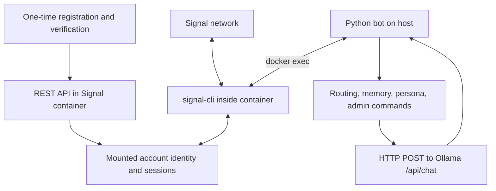

# Signal Assistant architecture

## Setup and runtime are separate paths

The container image is `bbernhard/signal-cli-rest-api`. Its REST endpoints provision the dedicated account and provide setup diagnostics. The application invokes a configured CLI executable directly for normal message transport. It does not call `/v2/send` or `/v1/receive`, subscribe to a WebSocket, or accept callbacks.

## Component map

| Module | Responsibility |
| --- | --- |
| `run_bot.py`, `signal_bot.bot` | Configuration, diagnostics, receive loop, task scheduling, routing, and replies. |
| `signal_client.py` | Docker-exec command construction, CLI deadlines, JSON parsing, direct/group sends, typing helper. |
| `signal_account.py` | Read local account readiness and resolve ACI/PNI sender identifiers through the account database. |
| `state.py` | Bounded history, group/sender scopes, chat locks, idle expiry, and runtime settings. |
| `llm.py` | Thread-local HTTP sessions for Ollama and DuckDuckGo; reply cleanup and search parsing. |
| `persona.py`, `commands.py` | Prompt templates, contact tone hints, and administrator command dispatch. |
| `data_cleanup.py`, `maintenance_cli.py` | Explicit attachment and selected SQLite send-log cleanup. |

## Receive, generate, and send

1. The host starts a bounded `docker exec` command with `timeout`, the configured CLI binary, container-side `--config`, JSON output, `-a BOT_NUMBER`, and `receive` options. Attachments, stories, avatars, and stickers are ignored.
2. The CLI returns JSON records. The client accepts one object or a list per line. The application extracts messages, sender identity, mentions, and group identifiers. Unknown service identifiers can be resolved through the mounted recipient database with a bounded cache.
3. Direct messages and qualifying group messages enter processing. Administrator actions verify the sender's number. Conversation history and contact/persona context form the model prompt.
4. Blocking model and CLI work runs in worker threads. A semaphore limits inference concurrency, and per-conversation locks preserve processing order.
5. The application sends the selected reply through CLI `send --message ...`, with a direct recipient or an incoming `--group-id`. The shared CLI lock prevents receive/send overlap. Pending sends take priority over another long receive call.

The application has a typing helper in its transport client but the normal processing loop does not call it. Think mode may perform a heuristic-triggered DuckDuckGo search before generating a longer reply.

## Account locking and persistence

Only one active CLI operation should own this account state. Use non-daemon container mode, avoid an automatic receive schedule, and stop the bot before manual REST/CLI maintenance. To maintain the account after `./stop_bot.sh`, start the container with `docker start signal-assistant-api` while leaving the Python bot stopped. The stop script stops both components.

| Host path | Container view / use |
| --- | --- |
| `signal-data/` | Mounted at `/home/.local/share/signal-cli`. |
| `signal-data/data/accounts.json` | Account index used by readiness checks. |
| `signal-data/data/<account-path>` | Account state; readiness expects `registered=true`. |
| `signal-data/data/<account-path>.d/account.db` | Recipient lookup and selected send-log tables. |

These layouts are upstream-version dependent. Recreating the container with the same mount retains account identity; recreating it without the mount does not. In-memory histories and settings disappear on restart. The stop script attempts cleanup of attachments and two send-log tables; it does not erase every database table, remote copy, or backup.

[SETUP.md](SETUP.md) documents dedicated-number registration and manual transport checks. [CONFIGURATION.md](CONFIGURATION.md) lists every environment variable, scope, and implementation limit.
