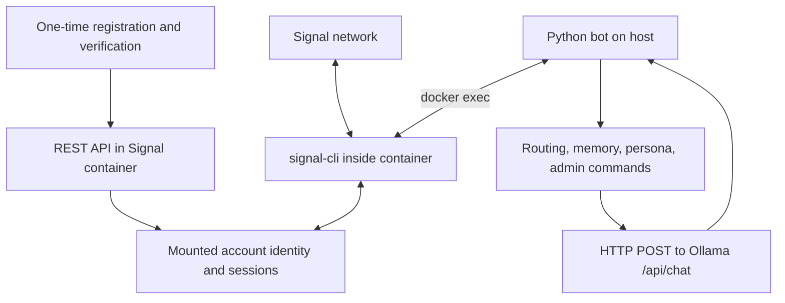

# Signal Assistant architecture

`bbernhard/signal-cli-rest-api` provisions the account through REST. Runtime messaging uses the CLI directly; the Python bot has no REST receive loop, WebSocket subscription, or callback server.

## Components

| Module | Responsibility |
| --- | --- |
| `run_bot.py`, `signal_bot.bot` | Diagnostics, receive loop, scheduling, routing, and replies. |
| `signal_client.py` | Docker-exec commands, CLI deadlines, JSON parsing, direct/group sends, typing helper. |
| `signal_account.py` | Local readiness checks and ACI/PNI sender resolution through the recipient database. |
| `state.py` | Bounded history, group/sender scopes, chat locks, idle expiry, and settings. |
| `llm.py` | Thread-local HTTP sessions for Ollama/DuckDuckGo, search parsing, and reply cleanup. |
| `persona.py`, `commands.py` | Prompt templates, contact tone hints, and administrator commands. |
| `data_cleanup.py`, `maintenance_cli.py` | Attachment and selected SQLite send-log cleanup. |

## Message flow

1. A bounded `docker exec` call runs the configured CLI with `timeout`, container-side `--config`, JSON output, `-a BOT_NUMBER`, and `receive` options. Attachments, stories, avatars, and stickers are ignored.
2. The client parses an object or list per JSON line. The application extracts sender, text, mentions, and group ID. A bounded cache and the mounted recipient database resolve unknown service identifiers.
3. Direct messages and qualifying group messages enter processing. Administrator handlers verify the sender; history, persona, and contact context form the model prompt.
4. Worker threads run blocking model/CLI calls. A semaphore bounds inference concurrency; per-conversation locks preserve order.
5. CLI `send --message ...` targets a direct recipient or incoming `--group-id`. A shared CLI lock prevents receive/send overlap, and pending sends take priority over another long receive call.

Think mode can search DuckDuckGo when query heuristics match. The transport's typing helper is available but unused by the normal processing loop.

## State and account ownership

The CLI lock coordinates this process only. External consumers can contend for the account or consume its messages; one bot instance should own the receive loop. [Setup](SETUP.md) covers compatible container modes and manual maintenance.

The bind mount persists account identity and sessions across container recreation. Histories and runtime overrides stay in memory and disappear on restart. [Configuration](CONFIGURATION.md) documents account paths, state scopes, and cleanup limits.
